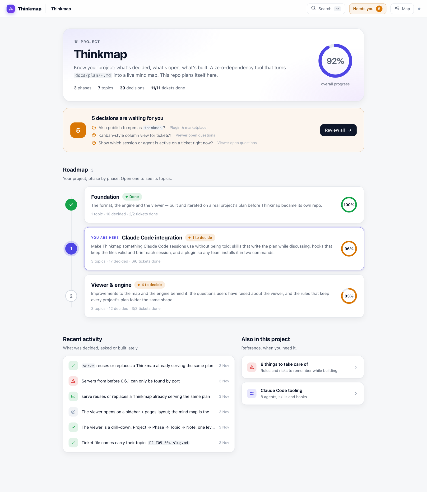
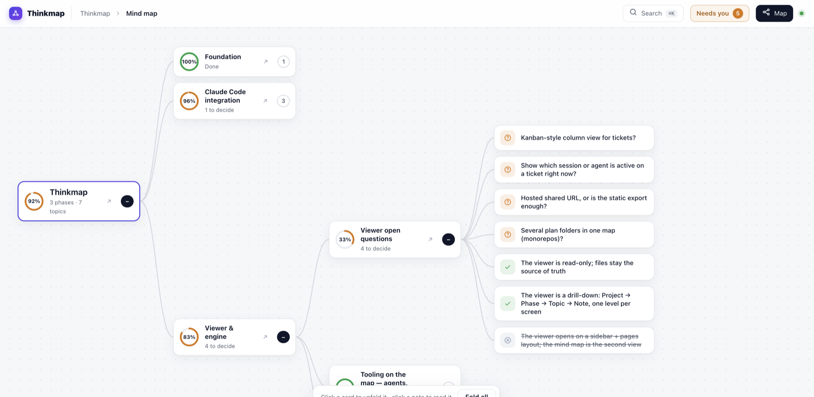
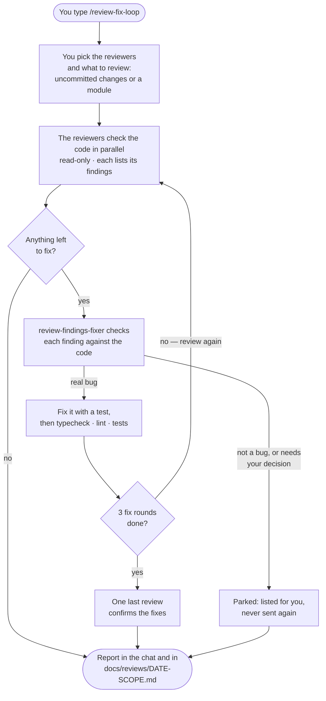

# Thinkmap

**Claude's planning memory for your project.**
What you decided, what's still open, what's being built — written down by Claude while you
talk, and shown as one clear dashboard.

[](https://github.com/dsngeu/ThinkMap/actions/workflows/test.yml)
[](https://github.com/dsngeu/ThinkMap/releases)
[](https://dsngeu.github.io/ThinkMap/)
[](#install)
[](LICENSE)

## Why

You plan a feature with Claude. Good decisions get made — and stay buried in the chat.
Next session, Claude doesn't know them. Neither does your teammate. A week later nobody
remembers *why* you picked Postgres, or which questions were never answered.

Thinkmap fixes that:

- **Claude writes the plan as you talk.** Say "let's go with Postgres" and it is saved in
  your repo as a decision, with the reason. Open questions, ideas and risks too.
- **Every new session starts informed.** Claude reads the plan first — no re-explaining.
- **You see where things stand at a glance.** A local dashboard shows what is decided, what
  is waiting for your answer, and what is being built, phase by phase.
- **From decisions to code.** Claude turns decisions into tickets; a session picks one up
  with its full context, and commits link back to it.

The plan is plain Markdown in `docs/plan/` — reviewed in pull requests like code. Nothing
leaves your machine.

## See it

**[Live demo →](https://dsngeu.github.io/ThinkMap/)** (this repo's own plan)



Click a phase to see its topics, a topic to see its decisions, a decision to read why.
Prefer a tree? The **Map** button shows the same plan as a mind map:



## Install

Inside [Claude Code](https://claude.com/claude-code), once per machine:

```
/plugin marketplace add dsngeu/ThinkMap
/plugin install thinkmap@thinkmap
```

## Use

Inside Claude Code, in any project:

| You | What happens |
|---|---|
| `/thinkmap-init` | Once per project: creates `docs/plan/` |
| *Just talk* | Claude records decisions, open questions, ideas and risks as you discuss |
| `/thinkmap` | Opens the dashboard in your browser. It updates live as the plan changes |

These three come with the plugin. The ticket and status skills are **add-ons**: you choose per
project. Open `/thinkmap`, click **Tooling**, tap **Add** — Thinkmap copies the skill into
the project's `.claude/skills/` (so your team gets it through git), and **Remove** deletes it again.
Start a new Claude session after adding, then type the command:

| Add-on | What happens |
|---|---|
| `/create-tickets P1` | Turns the decisions of phase 1 into tickets. You approve the list first |
| `/implement-ticket P1-T03` | Shows a brief of ticket P1-T03: decisions, risks, plan. Say "go ahead" and this session builds it and marks it done |
| `/plan-status` | A quick summary in the terminal |

## Ready-made review agents

The same Add button offers a small team of code-review **agents** and one **skill** that any
project can add. Each one first reads your project's `CLAUDE.md`, docs and package files to
learn your stack, and treats your project's rules as stronger than its own checklist.

| Name | Kind | What it does | Changes code? |
|---|---|---|---|
| `backend-code-reviewer` | agent | Reviews backend code: bugs, permissions, security, database, API, tests | No |
| `frontend-code-reviewer` | agent | Reviews frontend code: bugs, data caching, XSS, accessibility, tests | No |
| `fullstack-code-reviewer` | agent | Reviews both sides together and how they fit (shared types, permissions, errors). Before a commit it says whether the diff is ready | No |
| `data-isolation-reviewer` | agent | Checks no user can reach another user's data, and no customer another customer's | No |
| `review-findings-fixer` | agent | Takes a review's findings, checks each one, fixes real bugs with a test, pushes back on wrong ones | Yes, never commits |
| `/review-fix-loop` | skill | Runs the reviewers you pick, has the fixer fix, reviews again — up to 3 rounds | Through the fixer |

**Agent or skill?** An *agent* is a separate Claude with a fresh context and its own tool
limits: it does one job and reports back. The reviewers can only read, so a review can never
change your code. A *skill* is a set of instructions your main session follows when you type
`/name` — the loop has to be a skill, because only your main session can start agents.

### How the review-fix loop works



A fix counts as done only when the **next** review no longer reports it — never on the
fixer's word alone. The report shows each round: what was found, what was fixed, what was
pushed back, and what still needs you. Nothing is committed; you read the diff and commit.

### Add them to a project

Run `/thinkmap`, click **Tooling** in the top bar, and press **Add**. Thinkmap copies the agent or skill
into your project's `.claude/` folder, together with anything it needs, so the team gets it
through git like any other file. Start a new Claude session to use it.

| On the card | Meaning |
|---|---|
| **Not added** · Add | Not in this project yet |
| **Added** · Remove | Added and unchanged. Remove deletes only the files Thinkmap added |
| **Update available** · Update | A newer version came with a Thinkmap update |
| **Added · changed here** | You edited it, so Thinkmap leaves it alone |
| **Name taken** | Your project has its own file with that name. Thinkmap never overwrites it |

The same from a terminal, or for Claude to run:

```
thinkmap catalogue                     # list them, and which are added
thinkmap add fullstack-code-reviewer   # also adds the backend and frontend reviewers
thinkmap remove review-fix-loop
```

Thinkmap keeps a list of what it added in `.claude/thinkmap-catalogue.json`; commit it with
the files. The buttons only work in the map Thinkmap serves on your own machine, which
accepts them only from its own page. `thinkmap serve --read-only` turns them off.

## Update

```
claude plugin update thinkmap@thinkmap
```

Then start a new Claude session and run `/thinkmap` — it replaces the old dashboard by itself.
Coming from 0.8 or older? `/thinkmap-create-tickets`, `/thinkmap-implement-ticket` and
`/thinkmap-status` are now add-ons called `/create-tickets`, `/implement-ticket` and `/plan-status`:
add the ones you want once per project from the Tooling page.
If the update says there is nothing new, run `claude plugin marketplace update thinkmap` first.

## More

- **[Reference](docs/REFERENCE.md)** — every command, the plan file format, using Thinkmap
  without Claude Code (`npx`), and updating in detail
- **[Using it in another project](docs/USING-IN-ANOTHER-PROJECT.md)**
- Questions and ideas: [Discussions](https://github.com/dsngeu/ThinkMap/discussions) ·
  bugs: [Issues](https://github.com/dsngeu/ThinkMap/issues) · a ⭐ helps others find it

Zero dependencies · Node 20+ · MIT © Deepak Singh

## Contributing

```bash
npm test                              # no dependencies
node bin/thinkmap.js serve --open     # this repo plans itself in docs/plan/
```

Run `npm test` and `node bin/thinkmap.js validate docs/plan` before a pull request, and record
any decision you make in `docs/plan/`.
